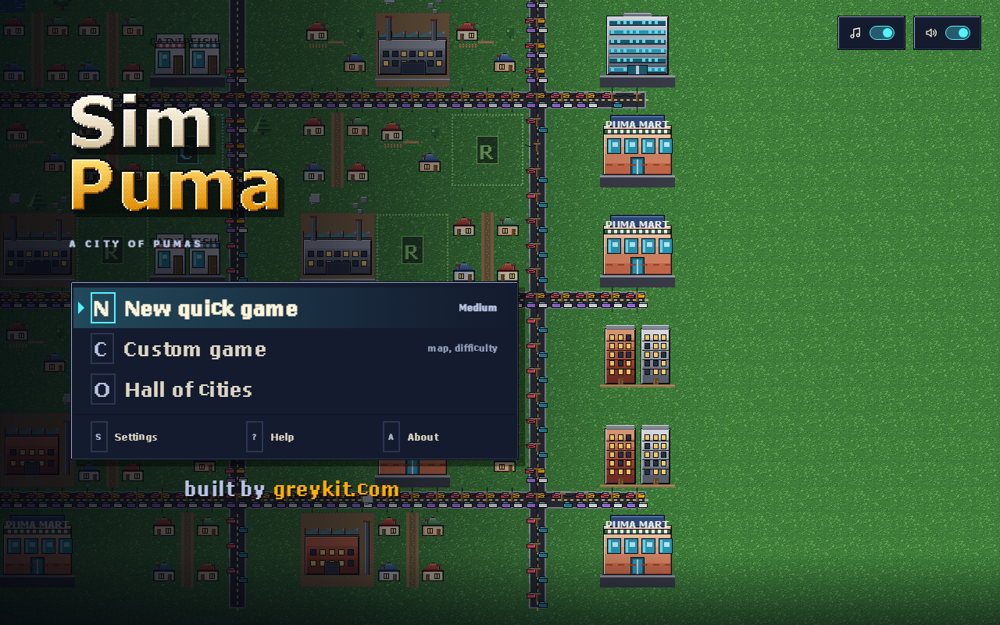
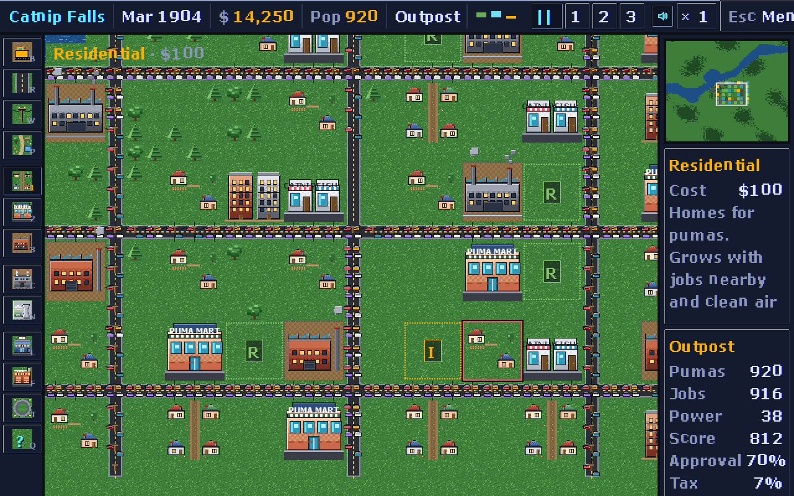

# SimPuma

**A city of pumas.** A remake of *SimCity* (Will Wright, Maxis, 1989) in 16-bit painted pixel art: zone, power, tax, and keep the pride happy through fires, floods and a very large kitten.

## Play

[greykit.com/games/simpuma](https://greykit.com/games/simpuma/)

One HTML file, runs in any modern browser, nothing fetched at play time.

## How it plays

You are the mayor. Build a power plant, zone **Residential**, **Commercial** and **Industrial** land in 3 by 3 blocks, run **power lines** to them and a **road** to each zone's edge, and the pumas move in. The RCI bars in the header say which kind the city wants more of. A zone grows a density at a time, to four, while its kind is in demand, it has power and a road, the land is worth something, and the air and the streets are clean; it shrinks when they are not. Industry does not mind smog. Residents do. Shops mind crime.

Every January the **budget** opens: tax income on every developed zone at your rate, against the roads and the police and fire stations at the funding you set. Pay, or turn on auto-budget and let the books close themselves. The **evaluation** gives the year a score out of 1,000 and an approval rating, and lists what the pumas complain about: crime, smog, traffic, taxes, jobs, dark zones, fires. The city grows from a **Den** through Outpost, Pride, Range and Dominion to a **Puma Nation**.

After the second year **disasters** strike at random, unless Settings turns them off: fire, flood, tornado, earthquake, a nuclear meltdown, and a giant kitten that comes for the smog and plays with whatever it finds. The Disasters window summons any of them on demand.

Tools: bulldozer, road (a bridge over water), power line, park, the three zones, coal and nuclear plants, police and fire stations, a stadium, and a query that tells you what a tile is and how it is doing. Three speeds and a pause; four ticks a month.

## Keys

| Key | Tool or action |
|---|---|
| B R W P | bulldozer, road, power line, park |
| 1 2 3 | residential, commercial, industrial zone |
| C N L F T | coal plant, nuclear plant, police, fire station, stadium |
| Q | query |
| Space , . | pause; slower, faster |
| Arrows | scroll the map; or drag with the right or middle button, or a finger |
| Z | zoom |
| G E D | budget, evaluation, disasters |
| M | sound |
| Esc | menu; closes a window |
| ? | help |

Left-drag paints roads, lines, parks and the bulldozer. Click the minimap to jump.

## Saves

The city in progress is saved in this browser every six months of city time and whenever you leave for the title, with the hall of cities and your settings, all under `simpuma_*`. Settings → This browser → Forget everything clears them.

## The look

Everything past the boot is 16-bit painted pixel art at 32 pixels a tile, drawn in code at load: the tiles, the buildings at four densities, the plants, the kitten. The lettering is **Pride**, the game's own 5×8 pixel font, built from `tools/font/glyphs.txt` and embedded in the page. The boot screen and the palette are the greykit.games Tactical canon.

## Credits

After SimCity by Will Wright, Maxis, 1989. Not affiliated with Maxis or Electronic Arts; no code, art or audio from the original is used.

By Matthew "Shan" Romanek, with Claude. Built by [greykit.com](https://greykit.com/).

Made for my own play. Nothing here is offered: no support, no updates, no licence.
